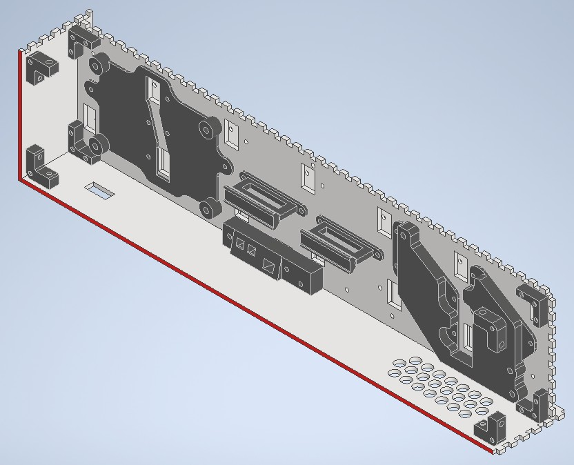
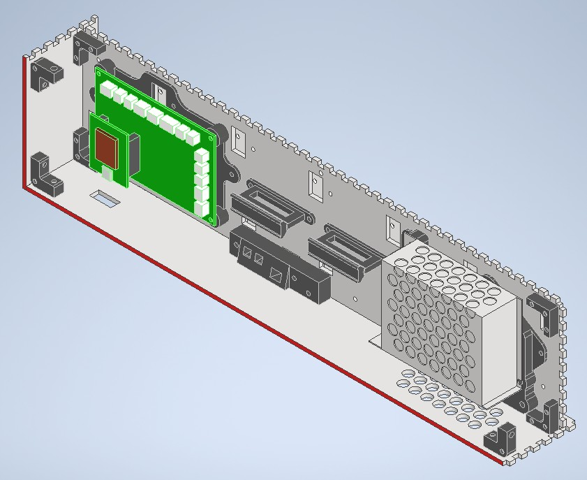

# Building the LED Display Board clock

Everything needed to build the clock: the printed parts (STL), the laser-cut
acrylic panels (DXF), the controller PCB, and the shopping list.

**Finished size:** about **406 × 96 × 60 mm** (W × H × D) — a 48 × 8 pixel
display made of six 8 × 8 WS2812B LED panels behind a clear front.

> ❓ = still to be confirmed by the maintainer — see *Open points* at the end.

---

## 1. What you need

### 1.1 Laser-cut panels (DXF) — 3 mm acrylic (Perspex)

All DXF files are in millimetres, one part per file, drawn at 1 : 1. The
panels are finger-jointed: the tabs are 3 mm deep, so cut them from
**3 mm** sheet (a different thickness will not fit together).

| File | Qty | Size (mm) | What it is |
|---|---|---|---|
| `FrontClearCover.dxf` | 1 | 400 × 90 | Clear front window in front of the LEDs ❓ colour / tint |
| `LEDBackplate.dxf` | 1 | 406 × 96 | Carries the six LED panels (connector slots, mounting holes) |
| `TopCover.dxf` | 1 | 406 × 60 | Top, with ventilation holes and slots for the front / back |
| `BottomCover.dxf` | 1 | 406 × 60 | Bottom, with ventilation holes and a rectangular cut-out ❓ (cable entry?) |
| `SideCoverx2.dxf` | **2** | 60 × 96 | Left and right side (cut the file twice) |
| `BackCover.dxf` | 1 | 400 × 90 | Back cover, with two keyhole slots to hang the clock on the wall |

Total sheet needed: roughly 410 × 400 mm of 3 mm acrylic (front in clear,
the rest ❓ colour — the clock in the pictures is black).

Holes: 3.2 mm = clearance for M3 screws, 8 mm = ventilation.

### 1.2 3D-printed parts (STL)

Print flat on the bed as exported (all parts are 8 mm high except the radar
holder and the wire support). ❓ filament (PLA / PETG), layer height, infill.

| File | Qty | Size (mm) | What it does |
|---|---|---|---|
| `FrontCorrnerMount.stl` | 4 ❓ | 20 × 20 × 8 | Corner brackets that hold the front window to the box |
| `BackCornerMount.stl` | 4 ❓ | 20 × 20 × 8 | Corner brackets that hold the back cover to the box |
| `PCBSupport.stl` | 1 | 126 × 82 × 8 | Holds the controller PCB on the LED backplate |
| `PowerSupplySupport.stl` | 1 | 121 × 82 × 8 | Holds the 5 V power supply on the LED backplate |
| `WireSupport.stl` | 2 ❓ | 57 × 12 × 23 | Wire trays / cable guides between the PCB and the power supply |
| `Radar_Pusbbotto_LigthSense_Holder.stl` | 1 | 75 × 16 × 16 | Holds the radar sensor, the push-button and the light sensor (LDR) |

### 1.3 Controller PCB

| File | What it is |
|---|---|
| `PCB/DevKitC_LED_DRIVER_V14_2026-05-23.zip` | **Gerber files — upload this ZIP to order the board** |
| `PCB/DevKitC_LED_DRIVER_V14.sch` / `.brd` | Eagle schematic and board (V14, 23 May 2026) |

The board is also shared on PCBWay, ready to order:
[DevKitC_LED_DRIVER_V14 (W93851ASE128)](https://www.pcbway.com/project/shareproject/W93851ASE128_DevKitC_LED_DRIVER_V14_2026_05_23_c0568fdb.html).
2 layers, 1.6 mm, default settings. It takes an **ESP32 DevKitC** (left
socket) — the right-hand footprint fits a WEMOS D1 Mini ESP32 instead.

### 1.4 Parts list (from `SparesList.xlsx`)

Links are to the sellers used for the prototype (AliExpress unless noted);
any equivalent part is fine.

**Box / wiring**

| Part | Qty | Notes | Where |
|---|---|---|---|
| 8 × 8 WS2812B LED panel (5050 RGB, 64 LEDs) | 6 | the display | [AliExpress](https://www.aliexpress.com/item/1005007273708016.html) |
| 2.54 mm single-row male header, 40 pin | 2 | connectors on the LED panels | [AliExpress](https://www.aliexpress.com/item/1005006181780843.html) |
| Dupont housing, 3 pin, 2.54 mm | 20 | LED panel links | [AliExpress](https://www.aliexpress.com/item/4001208456487.html) |
| Dupont crimp terminals (female / male), 2.54 mm | 100 | | [AliExpress](https://www.aliexpress.com/item/1005010383530380.html) |
| KF2510-T crimp terminals | 100 | for the KF2510 plugs below | [AliExpress](https://www.aliexpress.com/item/1005005909578343.html) |
| KF2510 plug housing, 4 pin | 1 | power to the PCB | [AliExpress](https://www.aliexpress.com/item/1005005909366834.html) |
| KF2510 plug housing, 3 pin | 3 | | (same link) |
| KF2510 plug housing, 2 pin | 4 | | (same link) |
| Microwave radar module, 10.525 GHz | 1 | wakes the display when someone is near | [AliExpress](https://www.aliexpress.com/item/1005007724089709.html) |
| GL5528 LDR (light-dependent resistor) | 1 | automatic brightness | [AliExpress](https://www.aliexpress.com/item/1005010099979166.html) |
| 5 V power supply, LM35-23B05 (35 W, enclosed, 230 V AC in) | 1 | Mornsun | [AliExpress](https://www.aliexpress.com/item/1005013142197519.html) |

**On the PCB**

| Part | Qty | Notes | Where |
|---|---|---|---|
| PCB DevKitC_LED_DRIVER_V14 | 1 | see 1.3 | [PCBWay](https://www.pcbway.com/project/shareproject/W93851ASE128_DevKitC_LED_DRIVER_V14_2026_05_23_c0568fdb.html) |
| ESP32-DevKitC (ESP32-32E) | 1 | the controller | [AliExpress](https://www.aliexpress.com/item/1005004441541467.html) |
| AMS1117-3.3 voltage regulator | 1 | | [AliExpress](https://www.aliexpress.com/item/1005004908874511.html) |
| 5 V active buzzer | 1 | | [AliExpress](https://www.aliexpress.com/item/1005006613648485.html) |
| Optocoupler (LTV316 footprint, EL817C fits) | 1 | | [AliExpress](https://www.aliexpress.com/item/1005011924740055.html) |
| SN74AHCT1G126DBVR buffer (3.3 V → 5 V for the LED data line) | 1 | ❓ the PCB is marked ...1G125 | [AliExpress](https://www.aliexpress.com/item/1005005936926220.html) |
| 220 µF / 25 V electrolytic capacitor | 3 | | [AliExpress](https://www.aliexpress.com/item/1005002075527957.html) |
| 0.1 µF ceramic capacitor | 2 | | [AliExpress](https://www.aliexpress.com/item/1005002290441861.html) |
| 0805 SMD resistors: 10k, 4k7, 330R (and 8R ❓) | 1 kit | 0R links can be bridged with solder | [AliExpress](https://www.aliexpress.com/item/4001321720241.html) |
| KF2510 male header, 4 pin | 1 | | [AliExpress](https://www.aliexpress.com/item/1005005909025593.html) |
| KF2510 male header, 3 pin | 2 | | (same link) |
| KF2510 male header, 2 pin | 2 | | (same link) |
| 2.54 mm male header, 40 pin | 1 | the two rows for the ESP32 socket | [AliExpress](https://www.aliexpress.com/item/1005006181780843.html) |
| 2.54 mm male header, 10 pin | 1 | cut into five 2-pin jumpers | (same link) |
| 2.54 mm jumper (shunt) | 2 | LINK 3.3V / LINK 5V | [AliExpress](https://www.aliexpress.com/item/1005011561770509.html) |
| 2N2222 transistor | 1 | buzzer driver ❓ not in the spreadsheet | |

**Not in the spreadsheet yet ❓**

- Push-button (stop / dismiss a message) — type and size for the holder
- M3 screws, nuts or brass inserts for the corner mounts and supports (lengths / quantities)
- Mains cable, plug, and how it enters the box (cable gland / grommet?)
- Hook-up wire for the LED panels and the radar / button / LDR

---

## 2. Building it

### Step 1 — Order and cut

1. Order the PCB (PCBWay link above, or upload the Gerber ZIP anywhere).
2. Laser-cut the six DXF files from 3 mm acrylic (the side twice).
3. Print the STL parts.

### Step 2 — Solder the PCB

Solder the SMD parts first (regulator, buffer, resistors), then the
through-hole parts (optocoupler, 2N2222, capacitors, buzzer, KF2510 headers,
the two header rows for the ESP32, cut from the 40-pin strip). Fit the jumpers on LINK 3.3V /
LINK 5V ❓ (which position for the DevKitC). Plug the ESP32 DevKitC in.

PCB connectors (silkscreen, GPIO in brackets):

| Connector | Goes to |
|---|---|
| POWER +5V (4 pin) | 5 V power supply |
| OUT ST (33) | data in of the first LED panel |
| RADAR / IN (23) | radar module |
| INPUT (27) | push-button |
| BUZZER (17) | on-board buzzer |
| LDR (35) ❓ connector name | light sensor |

### Step 3 — LED panels on the backplate

Fit the six 8 × 8 panels side by side on the front of the LED backplate,
connectors through the rectangular slots. Chain them with 3-pin Dupont leads (5 V, GND,
data): data out of one panel to data in of the next ❓ which panel is first
(left or right as seen from the front), and whether 5 V is fed only through
the chain or to more than one panel.

### Step 4 — Printed supports on the back of the backplate

Screw the **PCB support** (left) and the **power-supply support** (right) to
the back of the LED backplate, the **wire supports** in between, the
**radar / button / LDR holder** at the bottom edge, and the corner mounts in
the four corners.

### Step 5 — Box

Push the finger joints together: bottom, sides and top around the LED
backplate. ❓ glued (acrylic cement) or held only by the corner mounts?

### Step 6 — PCB, power supply and wiring

Mount the PCB on its support and the power supply on its support. Wire:

- 230 V mains → power supply input (L / N / earth). **Mains: have this done
  or checked by a qualified person.**
- Power supply 5 V output → PCB POWER and → the LED panels (the panels draw
  the most current; feed them directly, not through the PCB ❓).
- PCB → first LED panel data, radar, push-button, LDR.

Keep the wires in the wire trays, away from the mains terminals.

### Step 7 — Front and back

Fit the clear front window with the front corner mounts and the back cover
with the back corner mounts (M3). The keyholes in the back cover hang the
clock on two screws in the wall.

### Step 8 — Firmware and WiFi

Install the firmware from the [install page](https://777bdvgp.github.io/LED_Display_Board/)
(Chrome or Edge, USB cable to the ESP32 — before closing the back), then
connect a phone to the **LEDClock-Setup** hotspot and choose your WiFi. See
the main [README](../README.md).

---

## Open points ❓

To be filled in by the maintainer:

1. Acrylic colour of the box, and the front window (clear / tinted).
2. Filament and print settings; quantities of the corner mounts and wire supports.
3. Push-button type; screws / inserts (size, length, how many); mains cable entry.
4. Is the box glued or only screwed together?
5. Buffer chip: SN74AHCT1G126 (spreadsheet) or 1G125 (PCB silkscreen)?
6. 2N2222 and the 8R resistor — add to the spreadsheet?
7. LED panel order / direction and how they get their 5 V.
8. LINK 3.3V / LINK 5V jumper positions for the DevKitC.
