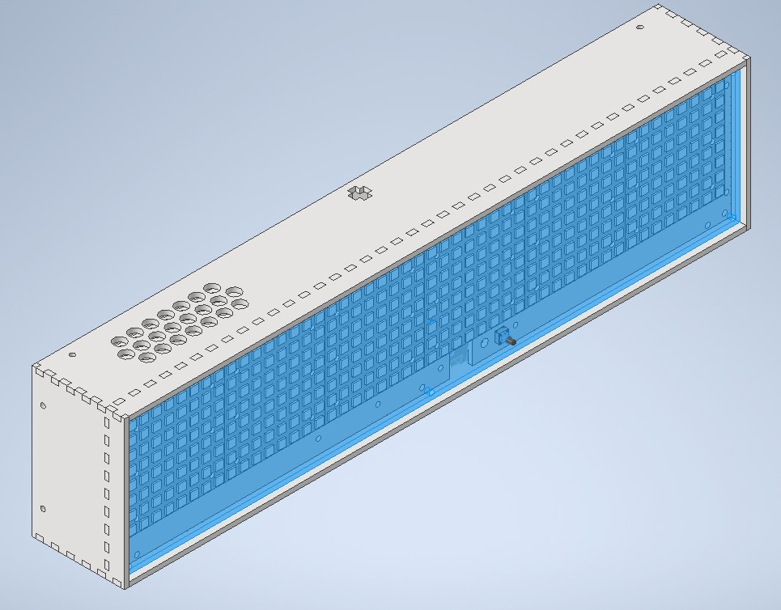
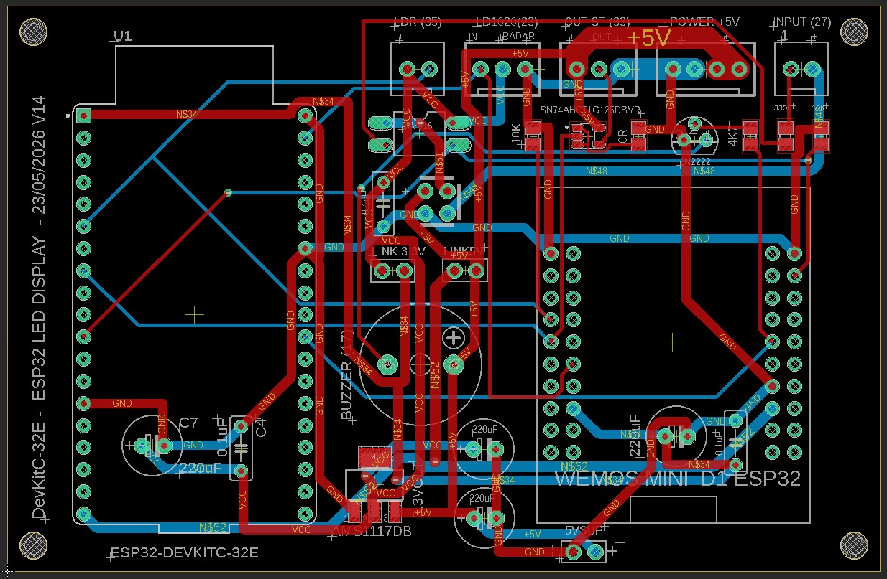
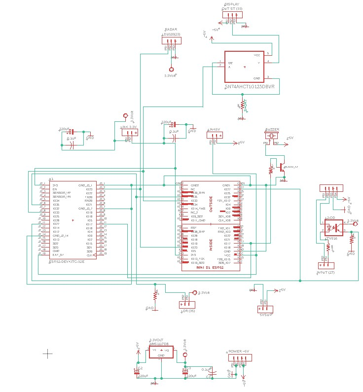
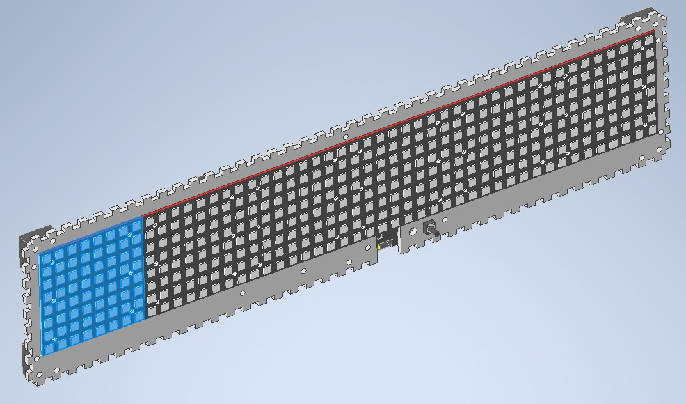
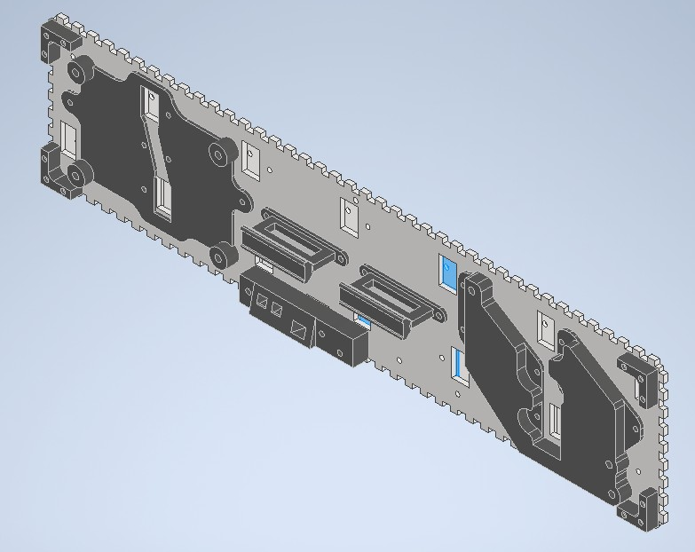

# Building the LED Display Board clock

Everything needed to build the clock: the printed parts (STL), the laser-cut
acrylic panels (DXF), the controller PCB, and the shopping list
([`SparesList.xlsx`](SparesList.xlsx)).

**Finished size:** about **406 × 96 × 60 mm** (W × H × D) — a 48 × 8 pixel
display made of six 8 × 8 WS2812B LED panels behind a clear front.

Quantities marked *(estimated)* were worked out from the drawings; check them
against your own parts.

---

## 1. What you need

### 1.1 Laser-cut panels (DXF) — 3 mm acrylic (Perspex)

All DXF files are in millimetres, one part per file, drawn at 1 : 1. The
panels are finger-jointed: the tabs are 3 mm deep, so cut them from
**3 mm** sheet (a different thickness will not fit together).

| File | Qty | Size (mm) | What it is |
|---|---|---|---|
| `FrontClearCover.dxf` | 1 | 400 × 90 | Front window in front of the LEDs — **clear** acrylic |
| `LEDBackplate.dxf` | 1 | 406 × 96 | Carries the six LED panels; the push-button and light sensor look through it |
| `TopCover.dxf` | 1 | 406 × 60 | Top, with ventilation holes |
| `BottomCover.dxf` | 1 | 406 × 60 | Bottom, with ventilation holes and an 18 × 8 mm slot for the mains cable |
| `SideCoverx2.dxf` | **2** | 60 × 96 | Left and right side (cut the file twice) |
| `BackCover.dxf` | 1 | 400 × 90 | Back cover, with two keyhole slots to hang the clock on the wall |

**Sheet needed (estimated):** one piece of **clear** 3 mm acrylic about
410 × 100 mm for the front window, and about **410 × 400 mm** of 3 mm acrylic
in the colour of your choice for the other six panels (the clock in the
pictures is black). Leave a few mm between parts for the laser.

Holes: 3.0–3.3 mm = M3 screws, 8 mm = ventilation, 5 mm = light sensor,
6.3 mm square = push-button.

### 1.2 3D-printed parts (STL)

Print flat on the bed as exported. Suggested settings *(not critical)*: PETG
or PLA, 0.2 mm layers, 3 walls, 20–30 % infill, no supports for the brackets.
PETG copes better with the warmth of the power supply.

| File | Qty | Size (mm) | What it does |
|---|---|---|---|
| `FrontCorrnerMount.stl` | 4 | 20 × 20 × 8 | Corner brackets that hold the front window to the box |
| `BackCornerMount.stl` | 4 | 20 × 20 × 8 | Corner brackets that hold the back cover to the box |
| `PCBSupport.stl` | 1 | 126 × 82 × 8 | Holds the controller PCB on the LED backplate |
| `PowerSupplySupport.stl` | 1 | 121 × 82 × 8 | Holds the 5 V power supply on the LED backplate |
| `WireSupport.stl` | 2 | 57 × 12 × 23 | Wire trays / cable guides between the PCB and the power supply |
| `Radar_Pusbbotto_LigthSense_Holder.stl` | 1 | 75 × 16 × 16 | Holds the radar sensor, the push-button and the light sensor (LDR) |

### 1.3 Controller PCB

| File | What it is |
|---|---|
| `PCB/DevKitC_LED_DRIVER_V14_2026-05-23.zip` | **Gerber files — upload this ZIP to order the board** |
| `PCB/DevKitC_LED_DRIVER_V14.sch` / `.brd` | Eagle schematic and board (V14, 23 May 2026) |

The board is also shared on PCBWay, ready to order:
[DevKitC_LED_DRIVER_V14 (W93851ASE128)](https://www.pcbway.com/project/shareproject/W93851ASE128_DevKitC_LED_DRIVER_V14_2026_05_23_c0568fdb.html).
2 layers, 1.6 mm, default settings.

**Two ESP32 boards fit — use either one (not both):** the
**ESP32-DevKitC-32E** in the left-hand socket (U1, marked ESP32-DEVKITC-32E),
or the **WEMOS D1 Mini ESP32** in the right-hand socket (marked WEMOS MINI D1
ESP32). Both work with the same firmware.

> **Recommended: the ESP32-DevKitC-32E** — the original Espressif board (the
> prototype's came from Espressif's own store on AliExpress, link in the parts
> list). With a single clock the WEMOS D1 Mini ESP32 worked fine, but with
> three clocks syncing with each other in the background, the WiFi traffic
> caused flicker / disturbances on the LED display with the WEMOS. The
> DevKitC-32E runs clean in that setup.

**Board layout** (Eagle, top copper red, bottom copper blue):

**Schematic:**

### 1.4 Parts list (also in [`SparesList.xlsx`](SparesList.xlsx))

Links are to the sellers used for the prototype (AliExpress unless noted);
any equivalent part is fine.

**Box / wiring**

| Part | Qty | Notes | Where |
|---|---|---|---|
| 8 × 8 WS2812B LED panel (5050 RGB, 64 LEDs) | 6 | the display | [AliExpress](https://www.aliexpress.com/item/1005007273708016.html) |
| 2.54 mm single-row male header, 40 pin | 2 | connectors on the LED panels | [AliExpress](https://www.aliexpress.com/item/1005006181780843.html) |
| Dupont housing, 3 pin, 2.54 mm | 20 | LED panel links | [AliExpress](https://www.aliexpress.com/item/4001208456487.html) |
| Dupont crimp terminals (female / male), 2.54 mm | 100 | | [AliExpress](https://www.aliexpress.com/item/1005010383530380.html) |
| KF2510-T crimp terminals | 100 | for the KF2510 plugs below | [AliExpress](https://www.aliexpress.com/item/1005005909578343.html) |
| KF2510 plug housing, 4 pin | 1 | power to the PCB | [AliExpress](https://www.aliexpress.com/item/1005005909366834.html) |
| KF2510 plug housing, 3 pin | 3 | | (same link) |
| KF2510 plug housing, 2 pin | 4 | | (same link) |
| Microwave radar module, 10.525 GHz | 1 | wakes the display when someone is near | [AliExpress](https://www.aliexpress.com/item/1005007724089709.html) |
| GL5528 LDR (light-dependent resistor), 5 mm | 1 | automatic brightness | [AliExpress](https://www.aliexpress.com/item/1005010099979166.html) |
| 5 V power supply, Mornsun LM35-23B05 (35 W, enclosed, 230 V AC in) | 1 | | [AliExpress](https://www.aliexpress.com/item/1005013142197519.html) |

**On the PCB**

| Part | Qty | Notes | Where |
|---|---|---|---|
| PCB DevKitC_LED_DRIVER_V14 | 1 | see 1.3 | [PCBWay](https://www.pcbway.com/project/shareproject/W93851ASE128_DevKitC_LED_DRIVER_V14_2026_05_23_c0568fdb.html) |
| ESP32-DevKitC-32E (original Espressif) | 1 | the controller — **recommended**, especially for more than one clock | [AliExpress](https://www.aliexpress.com/item/1005004441541467.html) |
| *or* WEMOS D1 Mini ESP32 (USB-C) | (1) | alternative, right-hand socket — fine for a single clock | search "D1 Mini ESP32" |
| AMS1117-3.3 voltage regulator | 1 | | [AliExpress](https://www.aliexpress.com/item/1005004908874511.html) |
| 5 V active buzzer | 1 | | [AliExpress](https://www.aliexpress.com/item/1005006613648485.html) |
| 2N2222 NPN transistor (TO-92) | 1 | buzzer driver | any electronics shop |
| Optocoupler LTV816 (EL817C fits the same footprint) | 1 | | [AliExpress](https://www.aliexpress.com/item/1005011924740055.html) |
| **SN74AHCT1G125DBVR** buffer (SOT-23-5) | 1 | 3.3 V → 5 V for the LED data line — see the note below | search "SN74AHCT1G125DBVR" |
| 220 µF / 25 V electrolytic capacitor | 3 | C2, C3 + C7 (DevKitC) or C6 (WEMOS) | [AliExpress](https://www.aliexpress.com/item/1005002075527957.html) |
| 0.1 µF ceramic capacitor | 2 | C1 + C4 (DevKitC) or C5 (WEMOS) | [AliExpress](https://www.aliexpress.com/item/1005002290441861.html) |
| 0805 SMD resistors: 10K (2), 4K7 (1), 330R (1) | 1 kit | | [AliExpress](https://www.aliexpress.com/item/4001321720241.html) |
| KF2510 male header, 4 pin | 1 | | [AliExpress](https://www.aliexpress.com/item/1005005909025593.html) |
| KF2510 male header, 3 pin | 2 | | (same link) |
| KF2510 male header, 2 pin | 2 | | (same link) |
| 2.54 mm male header, 40 pin | 1 | the header rows for the ESP32 socket you use | [AliExpress](https://www.aliexpress.com/item/1005006181780843.html) |
| 2.54 mm male header, 10 pin | 1 | cut into 2-pin headers | (same link) |
| 2.54 mm jumper (shunt) | 2 | one on LINK 5V (see step 2), one spare | [AliExpress](https://www.aliexpress.com/item/1005011561770509.html) |

> **Buffer chip — use the 1G125, not the 1G126.** On this board the enable
> pin (`!OE`) is tied to ground, which switches a **1G125** on. A 1G126 has
> the opposite enable and would keep the LED data line off — the display
> stays dark.

**Extra parts** *(estimated from the drawings)*

| Part | Qty | Notes |
|---|---|---|
| Tactile push-button, 6 × 6 mm, tall stem (about 13 mm) | 1 | stop / dismiss a message — pressed through the 4 mm hole in the front window |
| M3 × 10 mm screws | 60 | 16 for the corner mounts, 18 for the supports and holders, 24 for the LED panels |
| M3 nuts (or M3 brass heat-set inserts in the printed parts) | 60 | |
| Mains cable with plug, 2-core 0.75 mm², about 2 m | 1 | through the 18 × 8 mm slot in the bottom; a cable tie inside as strain relief |
| Hook-up wire, 22 AWG stranded | 3 colours × 2 m | red (5 V), black (GND), one colour for data |
| Small cable ties (100 mm) | 20 | wires along the wire supports |

---

## 2. Building it

### Step 1 — Order and cut

1. Order the PCB (PCBWay link above, or upload the Gerber ZIP anywhere).
2. Laser-cut the six DXF files from 3 mm acrylic (the side twice; the front
   from clear acrylic).
3. Print the STL parts.

### Step 2 — Solder the PCB

Look at the photo of the bare board above: every part position is marked on
the board.

1. SMD parts first: the AMS1117 regulator (bottom, "3.3VOLT"), the
   SN74AHCT1G125 buffer (top middle) and the 0805 resistors along the top
   edge, left to right:

   | Marking | Part |
   |---|---|
   | 10K | 10 kΩ, left of the buffer |
   | 0R | **0 Ω link — no resistor, just bridge the two pads with solder** |
   | 4K7 | 4.7 kΩ, right of the 2N2222 |
   | 330R | 330 Ω, under INPUT (27) |
   | 10K | 10 kΩ, under INPUT (27) |

2. Through-hole parts: the LTV816 optocoupler, the 2N2222, the buzzer
   (+ marked), the KF2510 headers, and the header rows for the ESP32 socket
   you use (cut from the 40-pin strip).
3. Capacitors — C1, C2, C3 always, plus the pair next to the ESP32 you use:

   | ESP32 board | Socket | Fit | Leave empty |
   |---|---|---|---|
   | ESP32-DevKitC-32E | left (U1) | C7 (220 µF) + C4 (0.1 µF) | C6, C5 |
   | WEMOS D1 Mini ESP32 | right | C6 (220 µF) + C5 (0.1 µF) | C7, C4 |

4. Jumpers: **LINK 5V fitted, LINK 3.3V open.** LINK 5V gives the ESP32 board
   its 5 V and it makes its own 3.3 V; LINK 3.3V would tie the PCB's AMS1117
   to the ESP32's 3.3 V — leave it open.
5. Plug the ESP32 into its socket — one board only.

PCB connectors (silkscreen, GPIO in brackets):

| Connector | Pins | Goes to |
|---|---|---|
| POWER +5V | 4 | 5 V power supply (− − + +) |
| OUT ST (33) | 3 | data in of the first LED panel (+ / OUT / −) |
| LD1020 / RADAR (23) | 3 | radar module |
| INPUT (27) | 2 | push-button |
| LDR (35) | 2 | light sensor (top left; GPIO 35 of the ESP32) |
| BUZZER (17) | — | the buzzer sits on the board |
| 5VSUP | 2 | spare 5 V (+) and GND pick-up point (bottom) — optional, leave open unless you need 5 V for something extra |

### Step 3 — LED panels on the backplate

Fit the six 8 × 8 panels side by side on the front of the LED backplate with
M3 screws (4 per panel), their connectors through the rectangular slots.
Chain them with short 3-pin Dupont leads (5 V, GND, data): data out of one
panel to data in of the next. The first panel's data in goes to OUT ST (33)
on the PCB.

### Step 4 — Printed supports on the back of the backplate

Screw the **PCB support** (left) and the **power-supply support** (right) to
the back of the LED backplate, the two **wire supports** in between, and the
**radar / button / LDR holder** at the bottom edge — the push-button behind
the square hole and the LDR behind the 5 mm hole. Fit the corner mounts in the
four corners.

### Step 5 — Box

Push the finger joints together: bottom, sides and top around the LED
backplate, and screw them to the corner mounts (M3).

### Step 6 — PCB, power supply and wiring

Mount the PCB on its support and the power supply on its support. Wire:

- Mains cable in through the slot in the bottom, a cable tie inside as strain
  relief, to the power-supply input (L / N, and earth if your cable has it).
  **Mains: have this done or checked by a qualified person.**
- Power-supply 5 V output → PCB **POWER +5V** and → the LED panels.
- PCB → first LED panel data, radar, push-button, LDR.

Keep the low-voltage wires in the wire supports, away from the mains terminals.

### Step 7 — Front and back

Fit the clear front window with the front corner mounts and the back cover
with the back corner mounts (M3). The keyholes in the back cover hang the
clock on two screws in the wall.

### Step 8 — Firmware and WiFi

Install the firmware from the [install page](https://777bdvgp.github.io/LED_Display_Board/)
(Chrome or Edge, USB cable to the ESP32 — before closing the back), then
connect a phone to the **LEDClock-Setup** hotspot and choose your WiFi. See
the main [README](../README.md).
