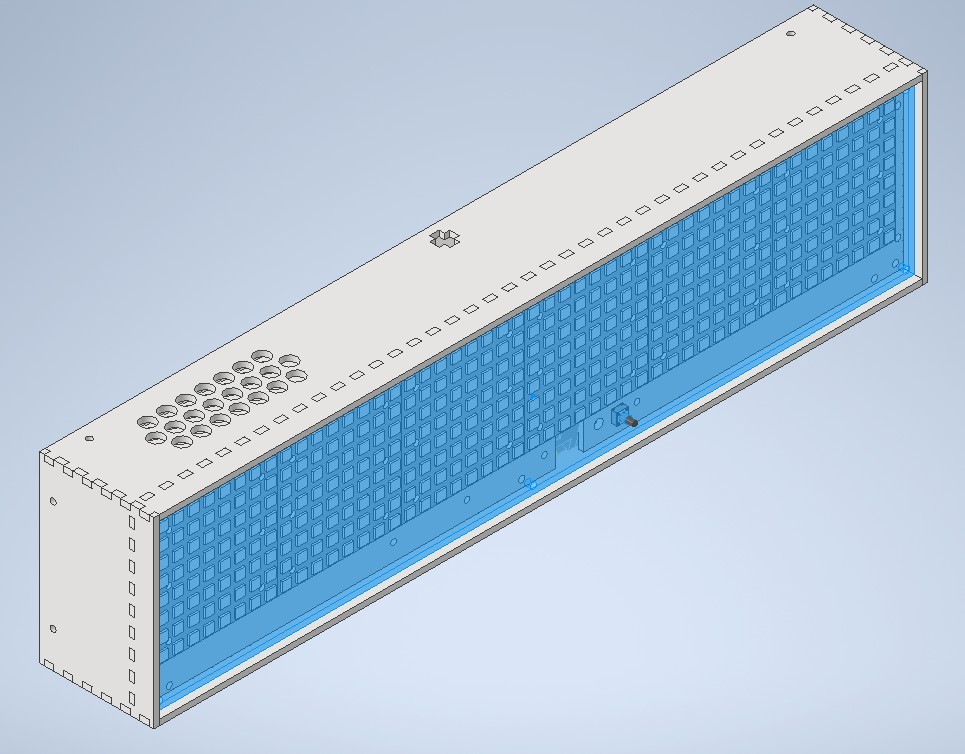

# LED Display Board

A WiFi LED-matrix clock for the house: it shows the time and scrolls
**birthdays, anniversaries and reminders** on the day, with a buzzer, an
optional radar sensor that wakes the display when someone is in the room, and
phone notifications through [ntfy](https://ntfy.sh). Everything is set up from
its own web pages on your WiFi — no cloud, no app.

Several clocks in one house keep each other in sync: add or change a reminder
on one clock and the others get it within seconds.

**Install page, pictures and updates:** https://777bdvgp.github.io/LED_Display_Board/

> **Status:** first public version. Still to come: a time-zone setting (the
> clock runs on South African time, UTC+2).

## Features

- **Clock** on a WS2812 (NeoPixel) LED matrix, time from the internet (NTP),
  brightness from a light sensor (LDR), display wakes on the radar sensor.
- **Birthdays & anniversaries** — shown on the day, with age.
- **Reminders** — once, daily, weekly, first/last weekday of the month or of
  one month a year; colour, buzzer pattern, repeat count, ntfy push.
  - **Valid Periods** — named sets of date ranges (e.g. school terms); a
    reminder can be limited to fire only inside them.
  - Grouped list (Daily / Weekly / Monthly / Yearly / Once / Expired) with search.
- **Quick reminder** — "remind me in 40 minutes" in two taps.
- **Exercises** — guided exercise programmes counted out on the display.
- **Multi-clock sync** — up to 4 clocks share birthdays, anniversaries,
  reminders and valid periods.
- **Backups** — CSV export / import of every list (Disk Tools).
- **Updates**: ABOUT → CHECK FOR UPDATE / INSTALL FROM GITHUB, or
  UPLOAD & INSTALL a `.bin` from the browser.

## WiFi setup

1. Install the firmware (see *Installing the firmware* below).
2. The clock opens the WiFi hotspot **LEDClock-Setup**. Connect a phone to it —
   the setup page opens by itself (otherwise browse to `http://192.168.4.1/`).
   Pick your network, type the password, choose a **fixed IP** (recommended)
   or **Automatic (DHCP)**, press **SAVE & RESTART**.
3. Put the phone back on your normal WiFi and open `http://<the clock's IP>/`.

**More networks:** OTHER → **WIFI NETWORKS** lists the saved networks (the
passwords are never shown) with **DELETE**, and **ADD NETWORK** for another
one. At start-up the clock tries the saved networks in range, strongest first.
If none can be reached for a few minutes, the **LEDClock-Setup** hotspot opens
for 5 minutes so you can add a network from a phone, then the clock restarts
and tries again.

## Hardware — build it yourself



Everything to build the clock is in [`Build_Files/`](Build_Files) — see its
**[build guide](Build_Files/README.md)**:

- STL files to 3D-print (corner mounts, PCB / power-supply / wire supports,
  radar + button + light-sensor holder),
- DXF files to laser-cut from 3 mm acrylic (front window, LED backplate, top,
  bottom, sides, back),
- `Build_Files/PCB/` — Eagle schematic + board (V14) and the Gerber ZIP to
  order the board (takes an **ESP32-DevKitC-32E** or a **WEMOS D1 Mini ESP32** —
  either one works),
- `SparesList.xlsx` — every part with where to buy it.

The clock is powered from 230 V mains through a small enclosed power supply —
have the mains wiring done or checked by a qualified person.

## Pin map

| Part | GPIO | Notes |
|---|---|---|
| LED matrix data (WS2812) | 33 | |
| Buzzer (2N2222) | 17 | |
| Radar presence sensor | 23 | digital output, HIGH = presence |
| Terminate push-button | 27 | active HIGH |
| LDR (light sensor) | 35 | ADC1 |
| Status LED | 2 | on-board blue LED; fast blink = WiFi connecting / setup hotspot |

## Installing the firmware

No PlatformIO needed: open the [install page](https://777bdvgp.github.io/LED_Display_Board/)
in Chrome or Edge, plug the ESP32 in with a USB data cable, press **CONNECT**,
choose **Erase**, then **Install**.

## Building the firmware yourself

ESP-IDF 5.3 through PlatformIO:

```
cd LED_Display_Board
pio run -e esp32dev -t upload          # USB
```

Each build writes `firmware_out/LED_Display_Board_v<ver>.bin` (update — ABOUT
page UPLOAD & INSTALL) and `..._full.bin` (new board, flash at 0x0).

Optional built-in WiFi networks and default ntfy topics:
`src/wifi_secrets.example.h` (your copy `wifi_secrets.h` is never committed).

Publishing a new version (maintainer): `python sync_from_private.py`, build,
`python update_firmware.py "note"`, commit, push.

## Licence

CC BY-NC 4.0 — see [LICENSE](LICENSE).
